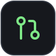
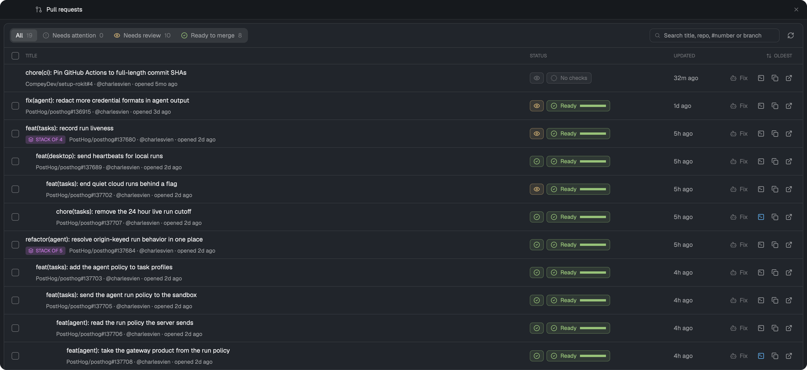
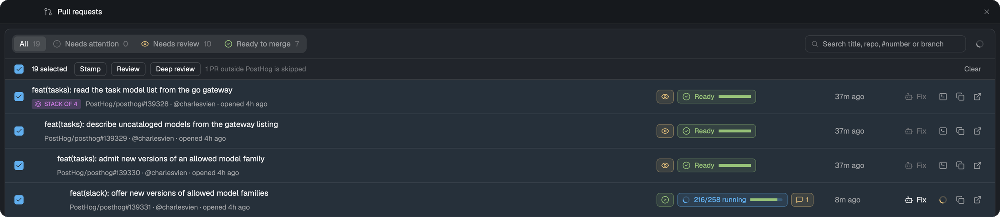

<p align="center">
  
</p>

<h1 align="center">Pull requests for Herdr</h1>

<p align="center">
  Every pull request you have open, with its stack, CI and reviews.<br>
  An app that lives inside <a href="https://herdr.dev">Herdr</a>, right next to your agents.
</p>

<p align="center">
  
  
  
</p>

<p align="center">
  
</p>

## What it does

- **Stacks as trees.** PRs that build on each other nest under a "STACK OF n" badge.
- **Status at a glance.** Review state, CI progress, conflicts and unresolved threads on every row.
- **Three filters.** Needs attention, Needs review and Ready to merge, each with a live count.
- **Fix.** Starts an agent on the PR's branch to get it mergeable. It reuses the worktree for that branch or makes one.
- **Jump to the branch.** The terminal button opens the space on that branch and shows when an agent is working there.
- **Bulk bot comments.** On PRs in the PostHog org, select many and post a review bot command on all of them after a confirm click. Other repos never show the checkboxes.
- **Sidebar count.** The Apps entry shows how many PRs need attention.

<p align="center">
  
</p>

## Install

You need Herdr and a logged-in `gh` (`gh auth login`).

**1. Copy both mods into your Herdr home.**

```sh
cp -R mods/pull-requests mods/apps ~/.config/herdr-app/mods/
```

**2. Put your work column in a stack, with the app beside it.**

This goes in your own layout. Still on the shipped one? Clone it first with `herdr-app do layout.clone '{"name":"main","as":"my-main"}'`.

```json
{
  "id": "views",
  "type": "stack",
  "active": "work",
  "children": [
    { "id": "work", "type": "column", "children": [] },
    {
      "id": "app-pull-requests",
      "type": "column",
      "resizable": false,
      "children": [
        {
          "id": "app-pull-requests-bar",
          "type": "block",
          "size": { "px": 42 },
          "window_drag": true,
          "content": { "mod": "apps", "props": { "bar": "pull-requests" } }
        },
        {
          "id": "app-pull-requests-body",
          "type": "block",
          "padding": 8,
          "content": { "mod": "pull-requests", "props": { "app": true } }
        }
      ]
    }
  ]
}
```

`work` is the column you already have. The ids `views` and `work` are the ones the Apps mod looks for.

**3. Add the Apps section to the bottom of your sidebar column.**

```json
{ "id": "apps", "type": "block", "size": { "px": 80 }, "content": { "mod": "apps" } }
```

## Using it

- Open it from **Apps** in the sidebar. Leave with Esc, the × in the title bar or by switching space.
- Hide the sidebar and the app fills the whole window.
- PRs in the PostHog org can be selected. Click a row, shift-click for a range, click a stack badge for its stack or use the header box for all of them.
- A bulk button asks once ("Post on 3 PRs?") before it comments.

Switching space or tab closes the app by itself. To also leave when you click the space you are already in, add this line to your spaces and agents mods, right before they select:

```js
if (shared("apps.open")) setShared("apps.open", null);
```

## Shortcuts

Nothing is bound by default. These commands work in `keys.json`:

| Command | What it does |
| --- | --- |
| `apps.pull-requests` | Open or close the app |
| `apps.close` | Back to your terminals |
| `pull-requests.refresh` | Fetch now |
| `pull-requests.filter` | Next filter |
| `pull-requests.sort` | Next sort order |
| `pull-requests.select` | Select or clear everything shown |

## Make it yours

The settings sit at the top of `mods/pull-requests/main.js`.

- `BULK_ACTIONS`: the comments the bulk buttons post.
- `BOT_OWNER`: the org whose PRs get checkboxes and bulk comments.
- `FIX_TASK`: the first message the Fix agent gets. By default it stops before committing or pushing.
- `STALE_DAYS`: PRs quieter than this fold away at the bottom of the list.

## How it works

One `gh api graphql` search for your open PRs, nothing else leaves your machine.

It refreshes every minute while CI is running, every three minutes otherwise and every five in the background.
