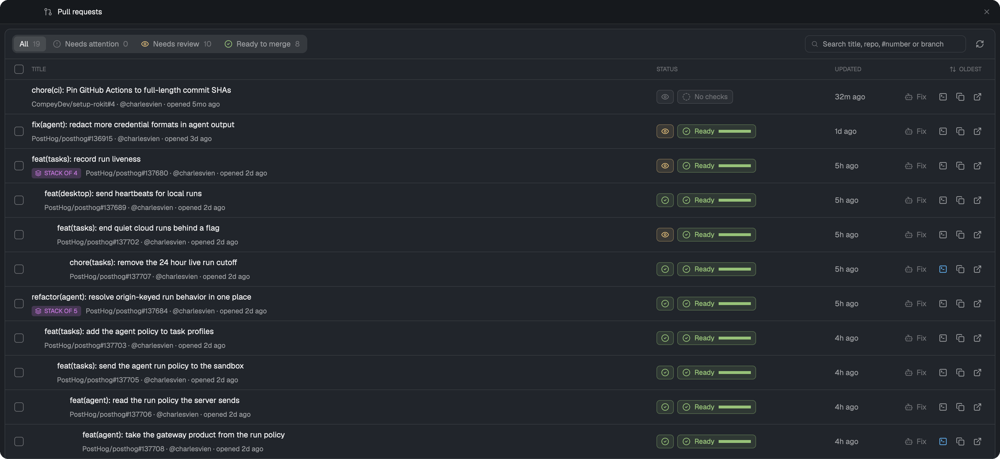

# Pull requests

An app page inside Herdr that lists every pull request you have open on GitHub. Stacked PRs show as a tree. Each row says where review and CI stand. From a row you can start an agent on the branch or jump to the space already working on it. It opens from an Apps section at the bottom of the sidebar and takes over the whole work area.



## What you see

**In the sidebar**, a new 80px section below the agents list.

- A header reading "Apps": 11.5px, medium weight, the theme's `dim` color, in a 41px strip.
- One 30px row: a 15px pull request icon in an 18px slot, then "Pull requests".
- A red count pill on the right when PRs need attention: 17px tall, at least 19px wide, `ansi1` text on `ansi1` at 18% alpha.
- The row takes the `selected` background while the app is open. No space or agent looks selected then.
- When the sidebar is narrower than 160px the section becomes a 32 by 26px icon cell with a 6px red dot.

**The app page**, in place of the tab bar and panes.

- A 42px title bar on the `chrome` color with a bottom border: the icon, "Pull requests" in 13px semibold and a 26px close button on the right.
- Below it, 8px of padding around one card: radius 10, a 1px border, the theme's `background`.

**Inside the card, top to bottom.**

- A 52px toolbar. On the left a segmented filter on the `raised` color: All, Needs attention, Needs review, Ready to merge. Each segment is 26px tall with a count. The last three carry a 14px icon in red (`ansi1`), amber (`ansi3`) and green (`ansi2`). On the right a 280 by 30px search field and a 28px refresh button.
- A 36px header row: TITLE, STATUS and UPDATED in 10.5px semibold `dim`, with a sort toggle on the far right.
- The list, one 60px row per PR.

**A row, left to right.**

- A 16px checkbox, only for PRs in the bot's org (see How it behaves).
- The title in 13.5px medium. Under it, in 12px `muted`: `owner/repo#number · @author · opened 4h ago`.
- The first PR of a stack has a "STACK OF n" badge: 18px tall, 10.5px semibold, `ansi5` text on `ansi5` at 22% alpha. Each PR built on another sits 22px further right.
- Drafts carry a "DRAFT" badge on the `raised` color.
- A 30 by 24px review pill: green check for approved, red alert for changes requested, amber eye for waiting, `dim` eye when no review is required.
- A 24px checks pill: "Ready" in green, "206/259 running" in blue (`ansi4`) with a spinner, "2 failing" in red, "Conflicts" in red or "No checks" in `dim`. On wide windows it ends with a 56 by 5px progress bar.
- An amber pill with a count when review threads are unresolved.
- When it last changed: "30m ago".
- Four actions in a 178px column: Fix, a terminal icon, copy and open.

Every pill uses the same recipe: its color for text, 35% alpha for the border and 12% alpha for the fill.

At the bottom, one quiet line when old PRs are hidden: "9 pull requests with no activity in 60 days are hidden" with a Show button.

## How it behaves

**Opening and leaving.**

- Clicking the Apps row opens the page. Clicking it again closes it.
- Esc closes it. So does the close button in the title bar.
- Switching space or tab closes it by itself, whether by click, key or toast.
- Hiding the sidebar leaves the app filling the window. The title then moves right to clear the macOS window buttons.
- Dragging the title bar moves the window.

**Agents.** The terminal icon on a row follows the space whose branch is that PR's branch.

- working: a spinner in the `working` color
- blocked: the icon in the `blocked` color
- done: the icon in the `done` color
- idle or a space with no agent: the icon in `accent`
- no space on that branch: the icon in `muted`

**Row actions.**

- Fix is lit when CI fails, changes were requested, the PR conflicts or threads are unresolved. It starts the first installed agent on the PR's branch with a task to get it mergeable. The task tells the agent to stop before committing or pushing.
- The terminal icon goes to the space on that branch or opens one.
- Both reuse the worktree that has the branch checked out. If there is none they create one and say so in a toast.
- Copy puts the PR link on the clipboard and shows a check for 1.4 seconds.
- Open hands the PR to the browser.

**Finding things.**

- The filter is exclusive and remembered. Needs attention means failing CI, changes requested or conflicts. Needs review means review is required on a PR that is not a draft. Ready to merge means approved, not a draft, no conflicts and CI passing or absent.
- The sort toggle cycles Newest, Oldest and Updated. Stacks move as one.
- Search matches title, `repo#number`, `@author` and branch. It also searches the hidden old PRs.
- Esc in the search field leaves the field first.

**Selecting and bulk comments.** Only PRs in one org can be selected: `PostHog` as shipped. If none of your PRs are in that org, the checkboxes and the bulk bar never appear.

- Click a row to select it. Shift-click selects the range. A stack badge selects its stack. The header checkbox selects all.
- With a selection the header row turns into a bar: "3 selected", then Stamp, Review and Deep review, then Clear.
- A button asks first. It turns solid and reads "Post on 3 PRs?" for 5 seconds. A second click posts.
- While posting it reads "Posting 2/3". Success shows a toast and clears the selection.
- A failed comment shows an error toast. Only the failed PRs stay selected.

**Refreshing.** Every minute while any CI is running, every three minutes otherwise and every five while the app is closed. The refresh button fetches now and spins while it does.

## Built from

**Layout.** The work column moves into a stack next to the app. The sidebar gains a block.

```json
{
  "id": "views", "type": "stack", "active": "work",
  "children": [
    { "id": "work", "type": "column", "children": [] },
    { "id": "app-pull-requests", "type": "column", "resizable": false, "children": [
      { "id": "app-pull-requests-bar", "type": "block", "size": { "px": 42 }, "window_drag": true,
        "content": { "mod": "apps", "props": { "bar": "pull-requests" } } },
      { "id": "app-pull-requests-body", "type": "block", "padding": 8,
        "content": { "mod": "pull-requests", "props": { "app": true } } } ] }
  ]
}
```

```json
{ "id": "apps", "type": "block", "size": { "px": 80 }, "content": { "mod": "apps" } }
```

**`mods/apps`.** Without props it draws the sidebar section. With `{ "bar": "<mod>" }` it draws that app's title bar. Every copy keeps the layout in step with one shared value on each render:

- `shared("apps.open")` is `{ mod, place }` or null, where `place` is `<active space id>:<active tab id>` at the moment the app opened.
- If `place` no longer matches, it sets the value to null and runs `layout.select { stack: "views", child: "work" }`.
- If the stack shows the wrong child, it runs `layout.select` to fix it.
- Closing on purpose also runs `pane.focus` so the keyboard returns to the terminal.
- Commands through `nextCommand()`: `apps.pull-requests` toggles, `apps.close` closes.

**`mods/pull-requests`.** `{ "app": true }` draws the card and takes the keyboard when opened. Without props it also works as a tab: `tab.new { mod: "pull-requests" }`.

- `main.js`: the view, selection and actions
- `github.js`: fetching, the three filter tests and the stack order
- `checkout.js`: finding the local repo, the worktree and the space for a branch
- Commands: `pull-requests.refresh`, `.filter`, `.sort` and `.select`
- It writes `shared("pull-requests.attention")` as `{ count, at }` after each fetch. The sidebar ignores a count older than 20 minutes.
- Filter, sort and the show-old choice persist in `localStorage`.

**From `herdr`:** `exec`, `spaces`, `panes`, `focused`, `layout`, `window`, `theme`, `settings`, `props`, `shared`, `setShared`, `run`, `notify`, `knownAgents`, `checking`, `nextCommand`, `home`, `appHome`, `readTextFile`.

**Commands run:** `layout.select`, `pane.focus`, `space.select`, `space.new { folder, tab, argv, task }`, `tab.new { space, folder, name, argv, task }`.

**Programs run.**

- `gh api graphql` with the search `is:pr is:open author:@me archived:false`, 60 results. One query reads title, branches, draft, fork, review decision, up to 50 review threads and the check rollup counts by state. A second reads only `mergeable`.
- `gh pr comment <url> --body <text>` for bulk comments, three at a time. As shipped the texts are `@PostHog stamp`, `@PostHog review` and `@PostHog review --deep`.
- `git rev-parse`, `git remote get-url origin`, `git worktree list --porcelain`, `git show-ref`, `git fetch origin` and `git worktree add`.

**Finding a checkout.** The repo is matched by its `origin` URL among the folders of open spaces and their sibling folders. New worktrees go to `<worktrees.directory>/<repo>/<branch>` from `settings.json`, by default `~/.herdr/worktrees`.

**Stacks.** A PR's parent is the open PR in the same repo whose head branch is its base branch.

**Art.** 24px stroke icons from Lucide, drawn with `svg()` so they take the text color.

## Watch out

- Keep `mergeable` out of the main query. Together with the check rollups GitHub answers 502. Fetch it beside the list and carry on without it if it fails.
- `window_drag` belongs on the title bar block only. On the body, a double click on a row maximizes the window.
- Every control inside a row must call `cx.stop_propagation()` in its click. Without it the click also toggles the row.
- A PR from a fork is never a parent. Fork branches are often called `main` and would adopt every PR based on `main`.
- Two PRs can point at each other. Walk each stack with a seen set or they vanish.
- Clicking the space you are already in changes nothing in Herdr, so the app cannot notice it. Your spaces and agents mods need one line before they select: `if (shared("apps.open")) setShared("apps.open", null);`. They should also skip their selected look while that value is set.
- Take the keyboard when the app opens. Otherwise typing still reaches the terminal hidden behind it.
- `<mod>.<command>` only reaches copies on screen. With the sidebar hidden and the app closed, `apps.pull-requests` reaches nothing.
- `flex_shrink()` needs a number.
- Skip the fetch while `checking()` is true.
- Limits: 60 PRs, 50 review threads per PR, this computer only.

## Done when

- `herdr-app check` passes for `mods/apps` and `mods/pull-requests`.
- `herdr-app do apps.pull-requests` shows the page and `herdr-app do apps.close` brings the terminals back.
- With the page open, `herdr-app do space.select --id <another space>` shows that space and leaves `apps.open` null.
- The All count equals your open PRs that changed in the last 60 days.
- A PR whose base is another open PR's branch sits 22px to the right of it, under a badge with the right count.
- With the sidebar hidden the title starts clear of the window buttons.
- With no PR in the bot's org there is no checkbox anywhere.
- A bulk button needs two clicks. A comment that fails leaves that PR selected.
